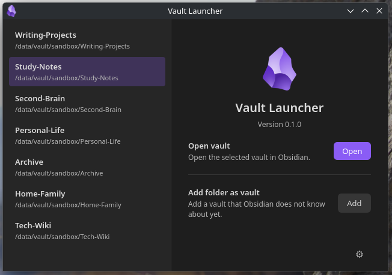
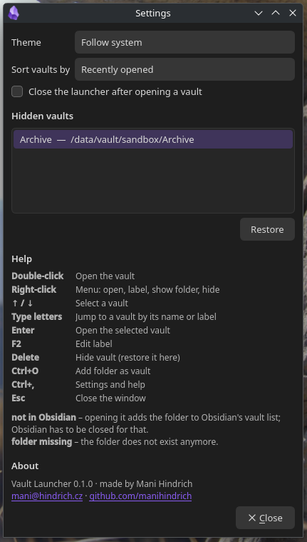

# Vault Launcher

**Choose which Obsidian vault to open, before Obsidian starts.**

All your [Obsidian](https://obsidian.md) vaults in one clean list, a click away. Work notes,
journal, that side-project wiki: jump straight into the one you need, not the one Obsidian
happened to open last. Fast, keyboard-friendly, and it looks right at home next to Obsidian.



## Why

Obsidian always reopens the vault you used last. If you keep several vaults, for example
work notes, a personal journal and a project wiki, you first land in the wrong one and then
have to go through the vault switcher.

Vault Launcher fixes the order: **start the launcher instead of Obsidian, pick a vault,
done.** It works like Obsidian's own vault chooser, but it is a normal application. You can
put it in your app menu, on a panel, on a keyboard shortcut or on the desktop.

It is handy if you:

- switch between several vaults during the day,
- keep vaults on other drives or in folders outside your home (`/data/…`, a NAS mount, …),
- want readable names for vaults whose folders are called `notes-2024-v2`,
- want to start Obsidian straight into the right vault from a launcher such as KRunner.

## Features

- **Finds your vaults automatically.** It reads the vault list from Obsidian (regular,
  flatpak and snap installs) and stays in sync while it is open. If a vault disappears from
  Obsidian, the launcher asks you whether to keep it or drop it. If its folder is gone too,
  the launcher simply drops it.
- **Add any folder** as a vault, including folders Obsidian does not know yet.
- **Your own labels.** Show "Work" instead of `company-kb-final`. The folder is not renamed.
- **Hide** vaults you do not need in the list. You can restore them at any time in Settings.
- **Remove a vault from Obsidian** right from the launcher. Your notes stay where they are.
- **Sort** by last use, by folder name or by label.
- **Looks like Obsidian.** It has a light, dark or "follow the system" theme.
- **Closes after opening a vault**, or stays open if you prefer.
- **Works from the keyboard.** Arrows, typing to search, Enter to open.



## Installation

You need Obsidian installed: the regular package, the Obsidian flatpak or the snap.

### Flatpak (any Linux distribution)

1. Download `vault-launcher.flatpak` from the
   [latest release](https://github.com/manihindrich/VaultLauncher/releases/latest).
2. Install it:

   ```sh
   flatpak remote-add --user --if-not-exists flathub https://dl.flathub.org/repo/flathub.flatpakrepo
   flatpak install --user vault-launcher.flatpak
   ```

   The first command adds Flathub, if you do not have it yet. The launcher needs the KDE
   runtime from there.
3. Start **Vault Launcher** from your application menu, or run
   `flatpak run io.github.manihindrich.VaultLauncher`.

To update, download the new `vault-launcher.flatpak` and install it again the same way.

> If the launcher does not show up in the menu right after installing flatpak for the first
> time, log out and back in.

### NixOS / Nix

Try it without installing:

```sh
nix run github:manihindrich/VaultLauncher
```

To install it permanently, add the flake to your NixOS or home-manager configuration:

```nix
# flake.nix
inputs.vault-launcher.url = "github:manihindrich/VaultLauncher";

# configuration.nix or home.nix
environment.systemPackages = [ inputs.vault-launcher.packages.${pkgs.system}.default ];
# or: home.packages = [ … ];
```

There is also an overlay, `inputs.vault-launcher.overlays.default`, which adds
`pkgs.vault-launcher`.

## Using it

| | |
|---|---|
| **Double-click** or **Enter** | open the vault |
| **Right-click** | menu: open, edit label, show folder in file manager, hide, remove from Obsidian |
| **↑ / ↓**, **typing letters** | select a vault |
| **F2** | edit the label |
| **Delete** | hide the vault (restore it in Settings) |
| **Ctrl+O** | add a folder as a vault |
| **Ctrl+,** | settings and help |
| **Esc** | close |

Badges in the list:

- **not in Obsidian**: Obsidian does not know this folder yet. See the next section.
- **folder missing**: the folder no longer exists, for example because a drive is not
  mounted. Once Obsidian no longer lists the vault either, it disappears from the launcher.

### Folders Obsidian does not know yet

Obsidian can only open folders that are in its own list of vaults. When you open a folder
like that for the first time, the launcher adds it to that list, just as Obsidian's "Open
folder as vault" would.

Obsidian reads the list only when it starts, so **Obsidian has to be closed** for this one
step. If it is running, the launcher asks you to close it and click Retry. After that, the
vault opens normally, whether Obsidian is running or not.

### Removing a vault from Obsidian

Right-click a vault and choose **Remove from Obsidian…**. The vault disappears from Obsidian's
list of vaults and from the launcher, just as if you removed it in Obsidian's vault manager.
The folder and your notes are not touched, and you can add the folder again at any time.
Obsidian has to be closed for this too.

## What it touches

- **Your vaults:** only reads them. Obsidian creates its `.obsidian` folder in a new vault, as
  usual.
- **Obsidian's settings:** only reads them, except when you add a folder Obsidian does not
  know yet or remove a vault from Obsidian (see above). Then it adds or removes one entry in
  Obsidian's `obsidian.json`, plus that vault's window state file when removing, as Obsidian
  does. It keeps the previous version as `obsidian.json.bak` and does this only while Obsidian
  is closed.
- **Its own data:** labels and hidden vaults are in
  `~/.local/share/vault-launcher/vaults.json`, settings in
  `~/.config/vault-launcher/settings.json`. For the flatpak, both are under
  `~/.var/app/io.github.manihindrich.VaultLauncher/`.
- **No network access.** The flatpak can read the file system, so that vaults outside your
  home folder work, and can write only to Obsidian's configuration folder.

## Building it yourself

### Flatpak

You need `flatpak`, `flatpak-builder` and the Flathub remote. On NixOS that means
`services.flatpak.enable = true;`. `flatpak-builder` also needs `appstreamcli`. On NixOS you
can get it temporarily with `nix shell nixpkgs#appstream`.

```sh
flatpak-builder --user --install --install-deps-from=flathub --force-clean \
    build-dir flatpak/io.github.manihindrich.VaultLauncher.yml
```

Single-file bundle, as published in the releases:

```sh
flatpak-builder --repo=repo --force-clean build-dir flatpak/io.github.manihindrich.VaultLauncher.yml
flatpak build-bundle repo vault-launcher.flatpak io.github.manihindrich.VaultLauncher \
    --runtime-repo=https://dl.flathub.org/repo/flathub.flatpakrepo
```

### Development

```sh
nix develop
python -m vault_launcher
pytest
ruff check .
desktop-file-validate data/*.desktop
appstreamcli validate --no-net data/*.metainfo.xml
```

## License

MIT, see [LICENSE](LICENSE).
Made by Mani Hindrich, <mani@hindrich.cz>, [github.com/manihindrich](https://github.com/manihindrich).

Vault Launcher is an independent project and is not affiliated with Obsidian.
